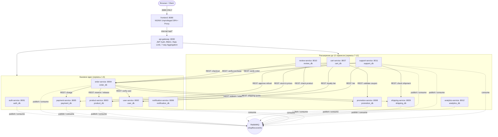
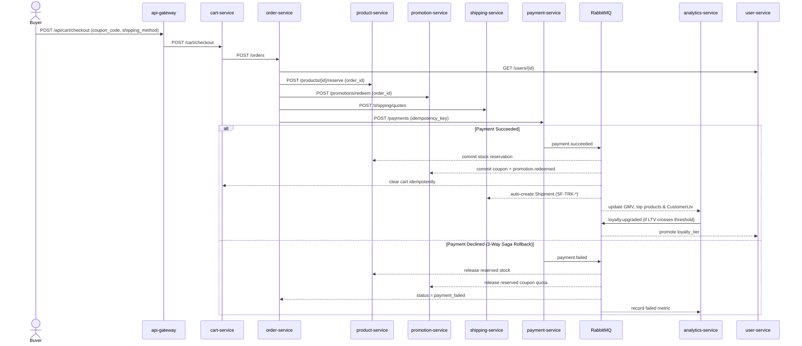

# Архитектура системы ShopFlow (12 бизнес-микросервисов)

## 1. Общая схема взаимодействия

## 2. Расширенный паттерн Saga, Fulfillment и CQRS

## 3. Принятые архитектурные решения

1. **Database per Service (12 БД)**: каждый из 12 микросервисов владеет собственной схемой данных (`auth_db` .. `analytics_db`), полностью исключая связанность на уровне SQL-таблиц.
2. **Ацикличный граф синхронных зависимостей (DAG) + Хореография RabbitMQ**:
   - Критичный путь оформления заказа, промокодов, расчёта доставки, верификации покупок и возвратов в саппорте работает синхронно через REST с таймаутами и компенсацией.
   - Побочные эффекты (создание профиля, welcome-купоны, очистка корзины, создание отгрузок, обновление рейтингов товаров, CQRS-проекции аналитики и автоматический апгрейд лояльности) выполняются асинхронно через Topic Exchange `shopflow.events`.
3. **CQRS Read Model (`analytics-service`)**: хранит денормализованные агрегаты (`DailyPlatformMetric`, `ProductAnalytics`, `CustomerLtv`) с дедупликацией по `event_id` (`ProcessedAnalyticsEvent`), не нагружая OLTP-таблицы `order-service` и `payment-service`.
4. **Единый `X-Request-ID`**: сквозной идентификатор запроса пробрасывается через Gateway, downstream HTTP-заголовки и `EventEnvelope.request_id`.
