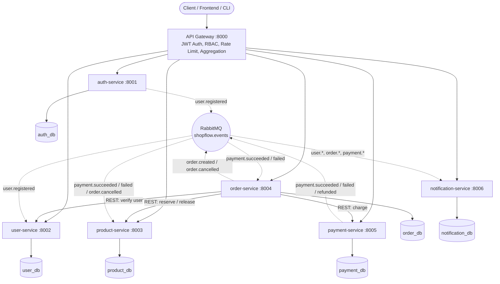
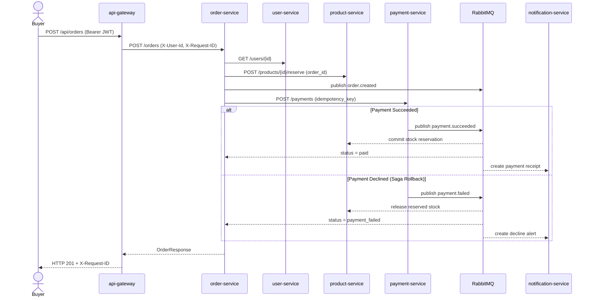

# Архитектура системы ShopFlow

## 1. Общая схема взаимодействия

## 2. Паттерн Saga (хореография с компенсацией)

## 3. Принятые архитектурные решения

1. **Database per Service**: 6 независимых БД (`auth_db` .. `notification_db`) исключают скрытую связанность через общие SQL-таблицы и позволяют масштабировать или менять СУБД каждого сервиса отдельно.
2. **Гибридная коммуникация (REST + RabbitMQ)**:
   - Критичный путь оформления заказа (`verify user`, `reserve stock`, `charge payment`) работает синхронно по REST для мгновенного отклика покупателю.
   - Побочные эффекты (создание профиля, уведомления, финальный коммит/откат склада, обновление статусов) идут асинхронно через RabbitMQ Topic Exchange `shopflow.events` с идемпотентной обработкой по `event_id` и `order_id`.
3. **Единый `X-Request-ID`**: генерируется или принимается на Gateway и пробрасывается как по HTTP-заголовкам, так и внутри `EventEnvelope.request_id` в RabbitMQ, связывая распределённые JSON-логи.
